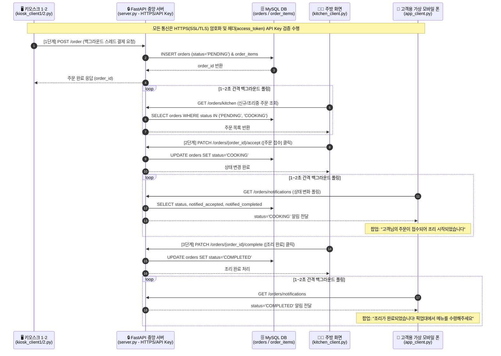
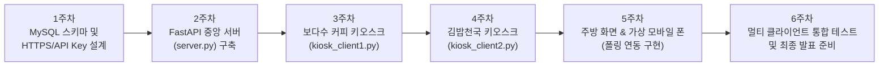

# 📋 멀티 클라이언트 키오스크 및 주방/고객 연동 시스템 개발 계획서 (Project Plan)

본 문서는 **'통신SW설계'** 과목의 7대 설계 조건과 조별 확정 요구사항(**FastAPI + MySQL + HTTPS(SSL/TLS) + API Key 인증 + 4종의 독립 Tkinter 클라이언트 + 백그라운드 폴링**)을 기반으로 작성된 **3인 팀 맞춤형 프로젝트 계획서 및 발표/디펜스 가이드**입니다.

---

## 1. 통신SW설계 7대 조건별 핵심 기획

### ① 주제 (Topic)
* **멀티 클라이언트 키오스크 및 주방/고객 실시간 연동 시스템**
  * 독립된 2대의 매장 키오스크(보다수 커피, 김밥천국)와 주방 디스플레이(KDS), **고객용 가상 모바일 폰**이 중앙 FastAPI 서버 및 MySQL DB를 통해 실시간으로 연동되는 통합 주문·조리·호출 시스템

---

### ② 배경 설명 (주제 선택 이유)
1. **현실 외식 매장의 단절된 주문-조리-호출 프로세스 개선**
   * 소규모 카페 및 분식점에서도 무인 키오스크 도입이 일반화되었으나, **① 매장별 상이한 커스텀 옵션(음료 온도 `HOT`/`ICE` vs 김밥 기호 재료 `당근`/`오이 제외`)** 처리, **② 주방 조리 현황판**, **③ 고객 모바일 픽업 알림**이 파편화되어 직원이 직접 주문서를 확인하고 번호를 호명하는 비효율이 존재함.
2. **멀티 클라이언트 통신 및 스레드 설계의 최적 실습 도메인**
   * 단순 1:1 에코 통신이 아니라, **주문 생성자(키오스크 1·2)**, **상태 변경자(주방 화면)**, **알림 수신자(고객용 가상 모바일 폰)**라는 서로 다른 역할을 가진 **4개의 독립 클라이언트가 단일 중앙 서버와 실시간으로 상호작용**하는 구조를 통해 멀티클라이언트 통신, 스레드 분리, DB 동시성 제어, 보안(HTTPS/API Key)을 종합적으로 검증할 수 있음.

---

### ③ 시스템 및 스레드 구성 (서버/클라이언트 역할 & 스레드 동기화 설계)

#### 1) 서버 및 멀티클라이언트 구성
* **중앙 서버 (`server.py`)**: `FastAPI` + `Uvicorn` 기반 REST API 서버로 다중 클라이언트의 동시 HTTP 요청을 비동기/멀티스레드로 완벽 지원하며, `MySQL` DB와 연동하여 주문 접수 및 조리 상태를 통합 관리함.
* **독립 클라이언트 4종 (`Tkinter`)**:
  1. `kiosk_client1.py`: 보다수 커피 키오스크 (`HOT`/`ICE`, 포장/매장식사, 수저 옵션)
  2. `kiosk_client2.py`: 김밥천국 키오스크 (`당근`/`오이` 제외, 포장/매장식사, 수저 옵션)
  3. `kitchen_client.py`: 주방 화면 (1~2초 주기 신규 주문 폴링 조회, `[주문 접수]` 및 `[조리 완료]` 처리)
  4. `app_client.py`: **고객용 가상 모바일 폰** (스마트폰 형태의 UI를 띄워 1~2초 주기로 주문 상태 변화 및 조리 완료 픽업 알림을 문자/알림톡 스타일로 폴링 수신)

#### 2) 멀티스레딩(Multi-threading) 적용 위치
* **키오스크 1·2**: 결제 버튼 클릭 후 서버와 HTTPS 통신을 수행하는 동안 메인 GUI 화면이 멈추는(Freezing/렉) 현상을 방지하기 위해 **백그라운드 작업 스레드(`threading.Thread`)** 사용.
* **주방 화면 & 고객용 가상 모바일 폰**: 메인 UI 루프와 독립적으로 **1~2초 간격으로 서버에 상태 조회(Polling)를 반복 수행하는 백그라운드 데몬 스레드** 구동.

#### 3) 스레드 동기화(`threading.Lock`) 미사용 이유 및 동시성 처리 방법
* **결론**: 파이썬 코드 레벨의 명시적 스레드 락(`threading.Lock`, `Mutex`, `Semaphore`)은 **미사용**.
* **이유 및 처리 방법**:
  1. **서버 측 공유 데이터 동기화 $\rightarrow$ 중앙 MySQL DB 트랜잭션에 위임**:
     * 서버 메모리의 전역 변수(In-Memory List/Dict)를 공유 메모리로 사용하지 않고 모든 상태 데이터를 중앙 **MySQL RDBMS**에 저장함.
     * 다중 클라이언트가 동시에 주문하거나 상태를 변경할 때 발생하는 경쟁 상태(Race Condition)는 **MySQL InnoDB 엔진의 트랜잭션(ACID)과 Row-level Lock(행 단위 잠금)**이 자동으로 직렬화하여 데이터 정합성을 100% 보장함.
  2. **클라이언트 측 UI 스레드 안전성 $\rightarrow$ `Tkinter` 메인 스레드 이벤트 큐(`root.after`)로 해결**:
     * 각 클라이언트 내부의 백그라운드 스레드는 오직 네트워크 통신(`requests`)만 수행하고 UI 위젯 메모리를 직접 수정하지 않음.
     * 통신 완료 후 화면 갱신은 `root.after()`를 통해 **Tkinter 메인 스레드 대기열에 순서대로 위임(Message Passing)**하므로, 공유 메모리 충돌 자체가 발생하지 않는 무잠금(Lock-free) 구조를 달성함.

---

### ④ 시스템 구축 명세 (UI, DB, 인증, 암호화)

| 구분 | 적용 기술 | 상세 구현 내용 |
| :--- | :--- | :--- |
| **UI 형태** | Python `Tkinter` | 내장 표준 GUI 라이브러리를 활용한 4종의 독립 데스크톱 클라이언트 구현 |
| **DB 연결** | `MySQL` (`pymysql`) | `stores`, `menus`, `orders`, `order_items` 4개 정규화 테이블 연동 |
| **클라이언트 인증** | **API Key 헤더 인증** | 클라이언트-서버 간 공유 비밀키를 HTTP 헤더(`access_token`)로 전송, FastAPI `Security(APIKeyHeader)`로 인가된 기기만 허용 (`403 Forbidden` 차단) |
| **통신 암호화** | **HTTPS (SSL/TLS)** | 자체 서명 SSL 인증서(`cert.pem`, `key.pem`)를 Uvicorn 서버 및 클라이언트에 적용하여 `access_token` 헤더와 주문 JSON 페이로드 전체를 암호화 전송 |

---

### ⑤ 프로젝트 목표 (정량적 지표 & 정성적 지표)

#### 📊 정량적 목표 (Quantitative Goals)
1. **핵심 REST API 구축 및 매칭률**: 주문 생성, 메뉴 조회, 주방 주문 폴링, 주문 접수, 조리 완료, 고객 알림 폴링 등 **핵심 서버 API 6종 100% 구현 및 요청-응답 스키마 매칭률 100%** 달성
2. **멀티 클라이언트 동시 처리 정합성**: **4개의 독립 클라이언트**가 동시에 구동 및 요청을 전송할 때 **주문 데이터 유실률 0% (MySQL 저장 성공률 100%)** 달성
3. **실시간 알림 동기화 지연 시간(Latency)**: 주방 화면에서 `[주문 접수]` 또는 `[조리 완료]` 클릭 후 **고객용 가상 모바일 폰**에 알림 팝업/메시지가 출력되기까지의 **종단 간(End-to-End) 반영 시간 2.0초 이내** 달성
4. **서버 응답 속도 및 UI 반응성**: 단건 주문(`POST /order`) 평균 응답 시간 **200ms 이내**, 백그라운드 스레드 분리를 통한 통신 중 **클라이언트 UI 멈춤(Freezing) 시간 0초**
5. **보안 차단율**: 미인가 API Key 또는 `access_token` 헤더 누락 요청에 대한 **서버 접근 차단율 100% (`HTTP 403 Forbidden`)**

#### ✨ 정성적 목표 (Qualitative Goals)
1. **매장 특화 맞춤형 UI/UX 제공**: 카페(`HOT`/`ICE`)와 분식점(`당근`/`오이 제외`)의 실제 주문 흐름을 직관적으로 반영한 키오스크 인터페이스 완성
2. **기밀성과 무결성을 갖춘 보안 통신**: HTTPS(SSL/TLS) 암호화와 API Key 인증의 이중 보안 설계로 패킷 감청 및 비인가 접근 원천 차단
3. **높은 확장성(Scalability)**: 무상태(Stateless) REST API와 중앙 DB 구조를 통해 추후 신규 매장 키오스크나 알림 단말기가 추가되어도 서버 구조 변경 없이 즉시 연동 가능

---

### ⑥ 3인 팀 맞춤형 업무 분담 (Role Division)

3명의 조원이 각각 **① 중앙 서버/DB/보안**, **② 키오스크 클라이언트 2종**, **③ 주방 화면 & 고객 앱 폴링 연동**을 전담하여 역할 경계가 명확하고 병렬 개발이 가능하도록 구성했습니다.

| 담당자 | 담당 파트 | 주요 담당 파일 | 세부 역할 및 개발 내용 |
| :---: | :--- | :--- | :--- |
| **팀원 1** | **백엔드 중앙 서버 & MySQL DB / 보안 설계** | `server.py` `database.py` `generate_cert.py` | • MySQL 4개 테이블(`stores`, `menus`, `orders`, `order_items`) 스키마 설계 및 초기 메뉴 23종 자동 Seeding • FastAPI 기반 주문/주방/알림 핵심 REST API 6종 구현 • SSL/TLS 자체 서명 인증서(`cert.pem`, `key.pem`) 발급 및 `access_token` API Key 보안 인증 모듈 구현 |
| **팀원 2** | **매장별 키오스크 클라이언트 2종 개발** | `kiosk_client1.py` `kiosk_client2.py` | • **보다수 커피 키오스크(`kiosk_client1.py`)**: 카테고리 탭, 음료 `HOT`/`ICE` 선택, 장바구니 Tkinter GUI 구현 • **김밥천국 키오스크(`kiosk_client2.py`)**: 김밥 전용 `당근 제외`/`오이 제외` 체크박스 옵션 및 식사류 UI 구현 • 공통 옵션(매장/포장, 수저 여부) 및 UI 렉 방지를 위한 백그라운드 스레드 HTTPS `POST /order` 통신 구현 |
| **팀원 3** | **주방 화면 & 고객용 가상 모바일 폰 (실시간 폴링 연동)** | `kitchen_client.py` `app_client.py` | • **주방 화면(`kitchen_client.py`)**: 1~2초 주기 신규 주문 백그라운드 폴링 스레드 및 `[주문 접수]` / `[조리 완료]` 비동기 상태 변경 구현 • **고객용 가상 모바일 폰(`app_client.py`)**: 스마트폰 프레임 형태의 Tkinter UI 및 1~2초 주기 상태 폴링 스레드로 조리 시작/픽업 완료 실시간 모바일 알림 구현 • `root.after()` 기반 Tkinter 메인 스레드 안전 UI 업데이트 및 전체 통합 시나리오 테스트 주도 |

---

### ⑦ 레퍼런스 (References)
* **공식 문서**:
  * FastAPI Official Documentation - Security & APIKeyHeader (`https://fastapi.tiangolo.com/tutorial/security/`)
  * Uvicorn Official Documentation - HTTPS / SSL Configuration (`https://www.uvicorn.org/deployment/#running-with-https`)
  * Python Official Documentation - `tkinter`, `threading` (`https://docs.python.org/3/library/threading.html`)
* **AI 활용 내역 (필수 첨부)**:
  * Google Gemini / Antigravity 아키텍처 설계, DB 스키마 정규화, 스레드 분리 및 HTTPS/API Key 구현 프롬프트 캡쳐본 첨부

---

## 2. 교수님 압박 질문 대비 디펜스 Q&A 가이드

> [!IMPORTANT]
> 발표 질의응답 시 교수님께서 질문하실 가능성이 높은 핵심 포인트와 모범 방어 논리입니다.

### Q1. "왜 파이썬에서 `threading.Lock` 같은 스레드 동기화를 사용하지 않았나요?"
* **A1 (서버 동시성 방어)**:
  "저희는 공유 데이터를 파이썬 서버의 메모리 변수(In-Memory)에 두지 않고 **중앙 MySQL 데이터베이스**에 두도록 아키텍처를 설계했습니다. 여러 키오스크가 동시에 주문 요청을 보내더라도 **MySQL InnoDB 엔진의 트랜잭션(ACID)과 행 단위 잠금(Row-level Lock)**이 데이터 충돌(Race Condition)을 DB 계층에서 완벽히 제어하므로, 파이썬 애플리케이션 코드에서 불필요한 전역 Lock을 걸어 성능을 저하시킬 필요가 없었습니다."
* **A2 (클라이언트 스레드 방어)**:
  "클라이언트(`Tkinter`) 내부에서도 백그라운드 스레드는 오직 서버와의 HTTPS 통신만 담당하고, UI 위젯 데이터 변경은 `root.after()`를 통해 **메인 스레드의 이벤트 큐로 작업을 위임(Message Passing)**하기 때문에 두 스레드가 동시에 같은 위젯 메모리를 수정하는 경쟁 상태 자체가 발생하지 않습니다."

### Q2. "실시간 알림인데 왜 TCP 소켓이나 웹소켓 대신 HTTP REST API와 1~2초 폴링(Polling)을 썼나요?"
* **A2**:
  "매장 주문 접수나 조리 완료 알림은 온라인 게임처럼 10ms 단위의 초저지연이 필요한 영역이 아니라 **1~2초 내외의 전달이면 충분한 비즈니스 도메인**입니다. 지속 연결(Stateful) 방식인 소켓은 매장 와이파이/네트워크가 잠깐만 끊겨도 연결 복구와 상태 재동기화가 까다롭지만, 무상태(Stateless) 기반의 **HTTPS REST API + 1~2초 주기 폴링**은 일시적인 네트워크 순단이 발생해도 다음 폴링 주기에 별도 재연결 로직 없이 즉시 복구되므로 매장 환경에서의 **내결함성(Fault Tolerance)**이 훨씬 뛰어납니다."

### Q3. "왜 ID/PW 로그인 대신 API Key(`access_token`)를 썼고, HTTPS는 왜 추가했나요?"
* **A3**:
  "키오스크와 주방 화면은 개인이 매번 로그인하는 서비스가 아니라 **매장에 고정된 전용 단말기 간 통신(M2M)**이므로 사전 공유된 비밀 API Key를 헤더(`access_token`)로 검증하는 방식이 적합합니다. 다만 일반 HTTP 환경에서는 패킷 스니핑 시 헤더의 API Key가 평문으로 노출될 수 있어, **HTTPS(SSL/TLS) 암호화**를 함께 적용해 API Key와 주문 데이터를 모두 안전하게 보호했습니다."

---

## 3. 전체 시스템 동작 시퀀스 및 DB/API 설계

### 3.1 시스템 시퀀스 다이어그램

### 3.2 MySQL 데이터베이스 테이블 구조 (4개 테이블)
1. **`stores`**: `store_id` (PK), `store_name`, `device_ip`
2. **`menus`**: `menu_id` (PK), `store_id` (FK), `category`, `menu_name`, `price`
3. **`orders`**: `order_id` (PK), `store_id` (FK), `order_type`, `spoon_needed`, `total_price`, `status` (`PENDING` / `COOKING` / `COMPLETED`), `notified_accepted`, `notified_completed`, `order_time`
4. **`order_items`**: `item_id` (PK), `order_id` (FK), `menu_id` (FK), `quantity`, `temperature`, `exclude_carrot`, `exclude_cucumber`

---

## 4. 6주차 주차별 개발 계획 (Weekly Roadmap)

| 주차 | 핵심 목표 | 담당 및 세부 작업 내용 | 산출물 |
| :---: | :--- | :--- | :--- |
| **1주차** | **요구사항 분석, DB 구축 및 SSL/보안 설계** | • **[공통]** API 명세 및 JSON 페이로드 규격 확정 • **[팀원 1]** `generate_cert.py`로 SSL 인증서(`cert.pem`, `key.pem`) 발급 및 `database.py` (4개 테이블 + 23종 초기 메뉴 시드) 구현 • **[팀원 2·3]** Tkinter 클라이언트 4종 화면 레이아웃 설계 | `generate_cert.py` `database.py` `PLAN.md` |
| **2주차** | **FastAPI 중앙 서버 (`server.py`) 개발** | • **[팀원 1]** FastAPI `Security(APIKeyHeader)` 기반 `access_token` 인증 및 HTTPS 적용, 핵심 REST API 6종 구현 • **[팀원 2·3]** 클라이언트 공통 HTTPS 통신 헬퍼 모듈 및 스레드 연동 구조 테스트 | `server.py` |
| **3주차** | **보다수 커피 키오스크 (`kiosk_client1.py`) 개발** | • **[팀원 2]** 보다수 커피 12종 메뉴 탭, `HOT`/`ICE` 선택, 매장/포장, 수저 옵션, 장바구니 UI 및 백그라운드 결제 스레드(`POST /order`) 구현 | `kiosk_client1.py` |
| **4주차** | **김밥천국 키오스크 (`kiosk_client2.py`) 개발** | • **[팀원 2]** 김밥천국 11종 메뉴 탭, 김밥 전용 `당근 제외`/`오이 제외` 체크박스 옵션, 장바구니 UI 및 백그라운드 결제 스레드 구현 | `kiosk_client2.py` |
| **5주차** | **주방 화면 (`kitchen_client.py`) & 고객용 가상 모바일 폰 (`app_client.py`) 개발** | • **[팀원 3]** 주방 화면 1~2초 주기 주문 폴링 스레드 및 `[주문 접수]`/`[조리 완료]` 상태 변경 구현 • **[팀원 3]** 고객용 가상 모바일 폰(스마트폰 UI) 1~2초 주기 알림 폴링 스레드 및 조리 시작/완료 모바일 알림 구현 | `kitchen_client.py` `app_client.py` |
| **6주차** | **5개 프로세스 통합 테스트 및 최종 발표** | • **[전원]** 서버 + 4개 클라이언트 동시 구동 테스트, 정량적 목표(응답속도 200ms, 폴링 반영 2초 이내, 미인가 차단율 100%) 측정 및 발표 자료 완성 | 최종 소스코드 및 발표자료 |
