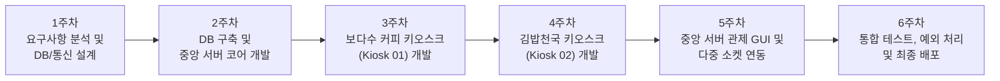

# 📋 다중 매장 키오스크 및 중앙 관리 서버 시스템 6주 개발 계획서 (Project Plan)

본 문서는 **Tkinter / CustomTkinter** 기반의 **보다수 커피(Kiosk 01)**, **김밥천국(Kiosk 02)** 키오스크 클라이언트와 **중앙 관리 서버(Central Server)**를 **6주 과정**으로 구축하기 위한 상세 설계 및 주차별 개발 계획서입니다.

---

## 1. 프로젝트 개요 및 기술 스택

### 1.1 프로젝트 목표
1. **CustomTkinter (또는 Tkinter) 기반 모던 GUI 구현**:
   * 매장별 특화 옵션(음료 온도 `HOT`/`ICE`, 김밥 기호 재료 `당근`/`오이` 제외)을 지원하는 키오스크 클라이언트 2종 구현
   * 실시간 주문 수신 현황 및 매출/주문 내역을 모니터링할 수 있는 중앙 관리 서버 GUI 구현
2. **멀티스레드 소켓(TCP/IP) 통신 구축**:
   * Python `socket` 및 `threading`을 활용하여 2대 이상의 키오스크 동시 접속 및 실시간 주문 패킷 처리
3. **정규화된 데이터베이스(SQLite / MySQL) 통합 관리**:
   * `stores`, `menus`, `orders`, `order_items` 4개 테이블을 통해 매장·메뉴·주문·세부 옵션을 체계적으로 저장 및 조회

### 1.2 기술 스택 (Tech Stack)
| 구분 | 사용 기술 및 라이브러리 | 비고 |
| :--- | :--- | :--- |
| **Language** | Python 3.x | 전체 시스템 개발 언어 |
| **UI Framework** | **Tkinter / CustomTkinter (`customtkinter`)** | 키오스크 2종 및 중앙 관리 서버 GUI 구현 |
| **Network** | Python `socket`, `threading` | TCP/IP 다중 클라이언트 비동기/동시 통신 |
| **Database** | SQLite3 (`sqlite3`) / MySQL (`pymysql`) | 주문 및 매장/메뉴 데이터 영속성 관리 |
| **IDE & VCS** | VS Code, Git / GitHub | 형상 관리 및 협업 (`bodasoo/bds-kiosk`) |

---

## 2. 6주차 개발 로드맵 (Weekly Roadmap)



### 📅 주차별 상세 계획

#### **1주차: 요구사항 분석, 아키텍처 설계 및 개발 환경 구축**
* **주요 목표**: 프로젝트 구조 확정, DB 스키마 및 소켓 패킷 프로토콜 정의, CustomTkinter 환경 구성
* **세부 작업**:
  * Python 가상환경 구성 및 필수 패키지(`customtkinter`, `pillow`, `pymysql` 등) 설치
  * Git 저장소(`bds-kiosk`) 브랜치 전략 수립 및 디렉토리 구조 생성
  * 4대 핵심 테이블(`stores`, `menus`, `orders`, `order_items`) ERD 및 DDL 확정
  * 매장별 전송 패킷 규격(`|` 구분자 프로토콜) 및 응답 코드(`OK`/`ERROR`) 정의
  * CustomTkinter 기반 키오스크/서버 화면 와이어프레임(레이아웃) 설계
* **산출물**: 프로젝트 계획서(`PLAN.md`), DB 스키마 설계서, 프로토콜 명세서

---

#### **2주차: 데이터베이스 구축 및 중앙 관리 서버(`server.py`) 백엔드 코어 개발**
* **주요 목표**: DB 자동 초기화/시드(Seed) 모듈 구현 및 멀티스레드 TCP/IP 소켓 서버 엔진 완성
* **세부 작업**:
  * `stores`(2개 매장) 및 `menus`(보다수 커피 12종, 김밥천국 11종 총 23종) 테이블 생성 및 초기 데이터 자동 적재 로직 구현
  * `socket` + `threading` 기반 다중 클라이언트 동시 접속 리스너 구현
  * 수신 패킷 파서(Parser) 구현:
    * `KIOSK_01` 패킷(7개 필드, `HOT`/`ICE` 온도 옵션) 분기 처리
    * `KIOSK_02` 패킷(8개 필드, `당근`/`오이` 제외 옵션) 분기 처리
  * 주문 수신 시 `orders` 및 `order_items` 테이블 트랜잭션 INSERT 로직 및 스레드 동기화(`threading.Lock`) 구현
* **산출물**: DB 초기화/연동 모듈, `server.py` 소켓 통신 및 패킷 파싱 코어, 더미 패킷 단위 테스트 스크립트

---

#### **3주차: 보다수 커피 키오스크(`kiosk_client.py`) GUI 및 주문 기능 개발**
* **주요 목표**: CustomTkinter를 활용한 보다수 커피 전용 키오스크 UI 및 소켓 주문 전송 구현
* **세부 작업**:
  * `CTkTabview`를 활용한 카테고리 탭(`커피`, `스무디`, `차/기타`) 및 메뉴 카드/버튼 그리드 구현
  * 음료 선택 시 **`HOT` / `ICE` 옵션 선택 모달(`CTkToplevel`) 또는 라디오 버튼(`CTkRadioButton`)** 구현
  * 우측 장바구니(`CTkScrollableFrame`) 담기, 수량 증감, 개별 삭제, 총 결제 금액 실시간 계산 기능 구현
  * 공통 옵션 선택 UI 구현: **`매장 식사` / `포장`**, **`수저 필요함` / `수저 필요없음`**
  * [주문하기] 클릭 시 `KIOSK_01|보다수 커피|...` 패킷 생성 후 중앙 서버로 소켓 전송 및 완료 알림창 표시
* **산출물**: `kiosk_client.py` (보다수 커피 키오스크 애플리케이션)

---

#### **4주차: 김밥천국 키오스크(`kiosk_client2.py`) GUI 및 주문 기능 개발**
* **주요 목표**: CustomTkinter를 활용한 김밥천국 전용 키오스크 UI 및 기호 재료 제외 옵션 구현
* **세부 작업**:
  * `CTkTabview`를 활용한 카테고리 탭(`김밥류`, `식사/분식류`) 및 메뉴 버튼 그리드 구현
  * **김밥류 전용 옵션 UI 구현**:
    * 김밥 메뉴 선택 시 **`당근 제외` / `오이 제외` 체크박스(`CTkCheckBox`)** 선택 기능 (미선택 시 `당근포함`, `오이포함` 기본 적용)
    * 일반 식사/분식류(돈가스, 라면, 우동, 떡볶이) 선택 시 기호 옵션 비활성화 또는 기본값 처리
  * 장바구니 관리, 공통 옵션(`매장 식사` / `포장`, `수저 필요 여부`) 선택 기능 구현
  * [주문하기] 클릭 시 `KIOSK_02|김밥천국|...` 패킷 생성 후 중앙 서버로 소켓 전송 및 결과 알림창 표시
* **산출물**: `kiosk_client2.py` (김밥천국 키오스크 애플리케이션)

---

#### **5주차: 중앙 관리 서버(`server.py`) 관제 GUI 고도화 및 실시간 연동**
* **주요 목표**: 중앙 서버에 CustomTkinter 기반 실시간 주문 모니터링 대시보드 GUI를 결합하고 다중 품목 주문 연동 완성
* **세부 작업**:
  * **중앙 서버 GUI 대시보드(`server.py`) 구현**:
    * 서버 시작/중지 제어 및 현재 접속 중인 키오스크 상태 표시
    * 실시간 주문 수신 현황 리스트(`ttk.Treeview` 또는 `CTkScrollableFrame`) 및 상세 옵션(`HOT`/`ICE`, `당근/오이 제외`, `포장 여부`, `수저 여부`) 표시
    * 매장별(`보다수 커피` vs `김밥천국`) 주문 건수 및 누적 매출액 실시간 집계 표시
    * 실시간 통신 패킷 로그 콘솔(`CTkTextbox`) 내장
  * GUI 메인 스레드와 소켓 수신 백그라운드 스레드 간 안전한 UI 업데이트(`after()` 또는 `queue.Queue`) 처리
* **산출물**: CustomTkinter 대시보드가 탑재된 통합 `server.py`

---

#### **6주차: 다중 매장 동시성 통합 테스트, 예외 처리 및 최종 산출물 정리**
* **주요 목표**: 서버 + 키오스크 2대 동시 구동 시나리오 검증, 네트워크 예외 처리 보완 및 문서화 마무리
* **세부 작업**:
  * **동시성(Multi-threading) 테스트**: `server.py`, `kiosk_client.py`, `kiosk_client2.py`를 동시에 실행하여 연속/동시 주문 시 DB 정합성 검증
  * **네트워크/입력 예외 처리 강화**:
    * 서버 미실행 또는 연결 끊김 상태에서 키오스크 주문 시 크래시 방지 및 재시도/오류 안내 팝업 처리
    * 장바구니가 비어있거나 필수 옵션 미선택 시 유효성 검사 알림
  * 코드 리팩토링, 주석 정리 및 `Readme.md` 최종 실행 매뉴얼 업데이트
* **산출물**: 최종 완성 소스 코드(`server.py`, `kiosk_client.py`, `kiosk_client2.py`), 테스트 결과 보고 및 최종 `Readme.md`

---

## 3. 데이터베이스(DB) 및 통신 규격 요약

### 3.1 데이터베이스 테이블 구조 (4개 테이블)
1. **`stores`**: `store_id` (PK), `store_name`, `device_ip`
2. **`menus`**: `menu_id` (PK), `store_id` (FK), `category`, `menu_name`, `price`
3. **`orders`**: `order_id` (PK), `store_id` (FK), `order_type`, `spoon_needed`, `total_price`, `order_time`
4. **`order_items`**: `item_id` (PK), `order_id` (FK), `menu_id` (FK), `quantity`, `temperature`, `exclude_carrot`, `exclude_cucumber`

### 3.2 소켓 통신 패킷 규격 (`|` 구분자)
* **보다수 커피 (`KIOSK_01`) 전송 예시**:
  ```text
  KIOSK_01|보다수 커피|포장|수저필요없음|아메리카노|3000|ICE
  ```
* **김밥천국 (`KIOSK_02`) 전송 예시**:
  ```text
  KIOSK_02|김밥천국|매장식사|수저필요함|참치김밥|4000|당근포함|오이제외
  ```

---

## 4. 개발 환경 실행 명령어 (Quick Start)

```bash
# 1. 필요 라이브러리 설치 (CustomTkinter 포함)
pip install customtkinter

# 2. 중앙 관리 서버 실행
python server.py

# 3. 각 매장 키오스크 클라이언트 실행 (개별 터미널)
python kiosk_client.py    # 보다수 커피 (KIOSK_01)
python kiosk_client2.py   # 김밥천국 (KIOSK_02)
```
