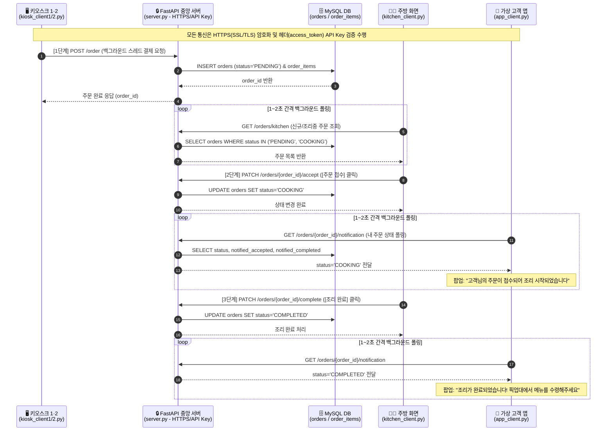
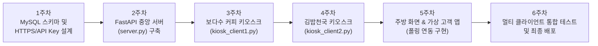

# 📋 멀티 클라이언트 키오스크 및 주방/고객 연동 시스템 6주 개발 계획서 (Project Plan)

본 문서는 [Readme.md](file:///c:/Bodasu/Readme.md)에 정의된 조별 확정 요구사항(**FastAPI + MySQL + HTTPS(SSL/TLS) + API Key 인증 + 4종의 독립 Tkinter 클라이언트 + 백그라운드 폴링**)을 기반으로 작성된 **6주 상세 개발 계획서**입니다.

---

## 1. 프로젝트 개요 및 아키텍처

### 1.1 핵심 목표
1. **중앙 집중형 보안 REST API 서버 (`server.py`) 구축**:
   * `FastAPI` + `Uvicorn` 기반 백엔드 서버와 `MySQL` 데이터베이스 연동
   * **HTTPS (SSL/TLS)** 통신 암호화(`cert.pem`, `key.pem`) 및 **API Key 헤더(`access_token`)** 기반 기기 인가 검증
2. **4종의 독립 `Tkinter` GUI 클라이언트 구현 및 실시간 연동**:
   * **보다수 커피 키오스크 (`kiosk_client1.py`)**: 음료 온도(`HOT`/`ICE`), 매장/포장, 수저 옵션 선택 및 비동기 결제 요청
   * **김밥천국 키오스크 (`kiosk_client2.py`)**: 기호 재료(`당근`/`오이` 제외), 매장/포장, 수저 옵션 선택 및 비동기 결제 요청
   * **주방 화면 (`kitchen_client.py`)**: 1~2초 주기 백그라운드 폴링으로 신규 주문 조회, **[주문 접수]** 및 **[조리 완료]** 상태 변경
   * **가상 고객 앱 (`app_client.py`)**: 1~2초 주기 백그라운드 폴링으로 내 주문의 **조리 시작 안내** 및 **조리 완료 픽업 알림** 팝업 수신

---

### 1.2 전체 시스템 시퀀스 다이어그램



---

## 2. 프로젝트 파일 구조 (예정)

```text
c:\Bodasu\
├── Readme.md               # 프로젝트 개요 및 시스템 아키텍처 설명서
├── PLAN.md                 # 6주 상세 개발 계획서 (본 문서)
├── generate_cert.py        # HTTPS용 자체 서명 SSL 인증서(cert.pem, key.pem) 생성 스크립트
├── database.py             # MySQL 연결, 테이블 자동 생성 및 초기 메뉴(23종) 시드 적재 모듈
├── server.py               # FastAPI 중앙 서버 (HTTPS, API Key 인증, 주문/주방/알림 REST API)
├── kiosk_client1.py        # 보다수 커피 키오스크 (Tkinter GUI + 비동기 주문 스레드)
├── kiosk_client2.py        # 김밥천국 키오스크 (Tkinter GUI + 비동기 주문 스레드)
├── kitchen_client.py       # 주방 화면 (Tkinter GUI + 1~2초 주기 주문 폴링 스레드)
└── app_client.py           # 가상 고객 앱 (Tkinter GUI + 1~2초 주기 알림 폴링 스레드)
```

---

## 3. 데이터베이스(MySQL) 및 REST API 상세 설계

### 3.1 MySQL 테이블 스키마 (4개 테이블)

1. **`stores` (매장/키오스크 기기 정보)**
   * `store_id` (`VARCHAR(20)`, PK): `KIOSK_01` (보다수 커피), `KIOSK_02` (김밥천국)
   * `store_name` (`VARCHAR(50)`, NOT NULL): 매장명
   * `device_ip` (`VARCHAR(45)`, DEFAULT `'127.0.0.1'`)
2. **`menus` (매장별 메뉴 마스터 - 총 23종)**
   * `menu_id` (`INT AUTO_INCREMENT`, PK)
   * `store_id` (`VARCHAR(20)`, FK $\rightarrow$ `stores.store_id`)
   * `category` (`VARCHAR(30)`): `커피`, `스무디`, `차/기타`, `김밥류`, `식사/분식류`
   * `menu_name` (`VARCHAR(50)`), `price` (`INT`)
3. **`orders` (주문 마스터 및 실시간 상태 정보)**
   * `order_id` (`INT AUTO_INCREMENT`, PK): 주문 번호
   * `store_id` (`VARCHAR(20)`, FK $\rightarrow$ `stores.store_id`)
   * `order_type` (`VARCHAR(20)`): `매장식사` / `포장`
   * `spoon_needed` (`VARCHAR(20)`): `수저필요함` / `수저필요없음`
   * `total_price` (`INT`): 총 결제 금액
   * `status` (`VARCHAR(20)`, DEFAULT `'PENDING'`): 주문 상태 (`PENDING`: 미접수 $\rightarrow$ `COOKING`: 조리중 $\rightarrow$ `COMPLETED`: 조리완료)
   * `notified_accepted` (`TINYINT(1)`, DEFAULT `0`): 고객 앱 주문접수 알림 수신 여부
   * `notified_completed` (`TINYINT(1)`, DEFAULT `0`): 고객 앱 조리완료 알림 수신 여부
   * `order_time` (`DATETIME`, DEFAULT `CURRENT_TIMESTAMP`)
4. **`order_items` (주문 세부 품목 및 옵션)**
   * `item_id` (`INT AUTO_INCREMENT`, PK)
   * `order_id` (`INT`, FK $\rightarrow$ `orders.order_id`)
   * `menu_id` (`INT`, FK $\rightarrow$ `menus.menu_id`)
   * `quantity` (`INT`, DEFAULT `1`)
   * `temperature` (`VARCHAR(10)`, NULL): `HOT` / `ICE` (보다수 커피 전용)
   * `exclude_carrot` (`VARCHAR(20)`, NULL): `당근포함` / `당근제외` (김밥천국 전용)
   * `exclude_cucumber` (`VARCHAR(20)`, NULL): `오이포함` / `오이제외` (김밥천국 전용)

---

### 3.2 FastAPI 엔드포인트 및 보안 명세

* **공통 보안**:
  * 프로토콜: `HTTPS` (`ssl_keyfile="key.pem"`, `ssl_certfile="cert.pem"`)
  * 인증 헤더: `access_token: <SHARED_SECRET_API_KEY>` (`FastAPI Security(APIKeyHeader)`)
* **주요 REST API 목록**:
  | 메서드 | 엔드포인트 | 호출 주체 | 설명 |
  | :---: | :--- | :--- | :--- |
  | `GET` | `/menus/{store_id}` | 키오스크 1·2 | 매장별 메뉴 목록 조회 |
  | `POST` | `/order` | 키오스크 1·2 | 신규 주문 생성 (`orders` 및 `order_items` 저장, 상태 `PENDING`) |
  | `GET` | `/orders/kitchen` | 주방 화면 | 미접수(`PENDING`) 및 조리중(`COOKING`) 주문 리스트 폴링 조회 |
  | `PATCH` | `/orders/{order_id}/accept` | 주방 화면 | **[주문 접수]** 처리 (`status`를 `COOKING`으로 변경) |
  | `PATCH` | `/orders/{order_id}/complete` | 주방 화면 | **[조리 완료]** 처리 (`status`를 `COMPLETED`로 변경) |
  | `GET` | `/orders/notifications` | 가상 고객 앱 | 상태 변경(`COOKING` 전환 / `COMPLETED` 전환) 알림 폴링 조회 및 수신 확인 처리 |

---

## 4. 6주차 개발 로드맵 (Weekly Roadmap)



### 📅 주차별 상세 개발 계획

#### **1주차: 요구사항 분석, MySQL 스키마 구축 및 HTTPS/보안 설계**
* **주요 목표**: 개발 환경 세팅, MySQL 연동, 자체 서명 SSL 인증서 발급 및 API 명세 확정
* **세부 작업**:
  * 필수 라이브러리(`fastapi`, `uvicorn`, `pymysql`, `requests`, `cryptography`) 환경 구축
  * `generate_cert.py` 작성하여 로컬 SSL/TLS 인증서(`cert.pem`, `key.pem`) 생성
  * `database.py` 구현: MySQL 데이터베이스 연결, 4개 테이블(`stores`, `menus`, `orders`, `order_items`) 생성 및 초기 메뉴 23종 시드(Seed) 데이터 자동 INSERT
  * 클라이언트-서버 공유 비밀키(`access_token`) 규격 및 JSON 요청/응답 스키마(Pydantic 모델) 정의
* **산출물**: `generate_cert.py`, `database.py`, SSL 인증서 파일, API/DB 설계 문서

---

#### **2주차: FastAPI 중앙 서버 (`server.py`) 및 보안/인증 모듈 개발**
* **주요 목표**: HTTPS와 API 키 검증이 적용된 FastAPI 중앙 서버의 전체 엔드포인트 구현
* **세부 작업**:
  * FastAPI `Security`(`APIKeyHeader(name="access_token")`) 기반 클라이언트 인증 미들웨어/의존성 구현 (미인가 요청 시 `403 Forbidden` 차단)
  * 주문 생성 API (`POST /order`) 구현: 트랜잭션 기반으로 `orders` 마스터 및 `order_items` 세부 옵션 저장
  * 주방용 주문 조회 API (`GET /orders/kitchen`), 주문 접수 API (`PATCH /orders/{id}/accept`), 조리 완료 API (`PATCH /orders/{id}/complete`) 구현
  * 고객 앱용 알림/상태 조회 API (`GET /orders/notifications`) 구현
  * Uvicorn SSL 옵션(`ssl_keyfile`, `ssl_certfile`) 적용 및 Swagger UI(`https://127.0.0.1:8443/docs`) 테스트
* **산출물**: `server.py` (FastAPI 중앙 서버 완성본)

---

#### **3주차: 보다수 커피 키오스크 (`kiosk_client1.py`) 개발**
* **주요 목표**: `Tkinter` 기반 보다수 커피 키오스크 GUI 및 백그라운드 스레드 주문 요청 구현
* **세부 작업**:
  * 카테고리 탭(`커피`, `스무디`, `차/기타`) 및 12종 음료 메뉴 선택 버튼 레이아웃 구현
  * 음료별 **`HOT` / `ICE`** 라디오 버튼 선택 UI 및 공통 옵션(**`매장 식사` / `포장`**, **`수저 필요함` / `수저 필요없음`**) 구현
  * 장바구니 담기, 수량 조절, 항목 삭제, 실시간 총 결제 금액 표시 기능 구현
  * **[결제하기(주문)]** 클릭 시 UI 멈춤(렉) 방지를 위해 `threading.Thread`로 `POST /order` (HTTPS + `access_token` 헤더) 호출 및 주문 번호 안내 팝업 출력
* **산출물**: `kiosk_client1.py`

---

#### **4주차: 김밥천국 키오스크 (`kiosk_client2.py`) 개발**
* **주요 목표**: `Tkinter` 기반 김밥천국 키오스크 GUI 및 김밥 전용 기호 옵션(`당근`/`오이` 제외) 구현
* **세부 작업**:
  * 카테고리 탭(`김밥류`, `식사/분식류`) 및 11종 메뉴 선택 버튼 레이아웃 구현
  * **김밥류 전용 옵션**: 김밥 선택 시 **`당근 제외` / `오이 제외`** 체크박스 활성화 (식사/분식류 선택 시 비활성화 또는 기본값 처리)
  * 공통 옵션(`매장 식사` / `포장`, `수저 필요 여부`) 및 장바구니 관리 구현
  * 백그라운드 스레드를 통한 HTTPS 주문 전송(`POST /order`) 및 완료 팝업 연동
* **산출물**: `kiosk_client2.py`

---

#### **5주차: 주방 화면 (`kitchen_client.py`) 및 가상 고객 앱 (`app_client.py`) 폴링 연동 개발**
* **주요 목표**: 1~2초 주기 백그라운드 폴링 스레드를 활용한 주방 접수/조리완료 및 고객 앱 실시간 알림 구현
* **세부 작업**:
  * **주방 화면 (`kitchen_client.py`)**:
    * 백그라운드 데몬 스레드에서 1~2초 간격으로 `GET /orders/kitchen` 폴링
    * 매장 구분(보다수 커피 / 김밥천국), 메뉴, 세부 옵션(`HOT`/`ICE`, `당근/오이 제외`, `포장`, `수저`), 현재 상태를 카드/리스트 형태로 표시
    * **[주문 접수]** 버튼 클릭 시 비동기 스레드로 `PATCH /orders/{id}/accept` 호출
    * **[조리 완료]** 버튼 클릭 시 비동기 스레드로 `PATCH /orders/{id}/complete` 호출
  * **가상 고객 앱 (`app_client.py`)**:
    * 백그라운드 데몬 스레드에서 1~2초 간격으로 서버에 주문 상태 변화 폴링 조회
    * 주방에서 **[주문 접수]** 시: *"고객님의 주문이 접수되어 조리 시작되었습니다"* 알림 팝업 및 상태 표시
    * 주방에서 **[조리 완료]** 시: *"조리가 완료되었습니다! 픽업대에서 메뉴를 수령해주세요"* 픽업 알림 팝업 표시
  * 모든 UI 업데이트는 `Tkinter` 메인 스레드 안전 규칙(`root.after()`) 준수
* **산출물**: `kitchen_client.py`, `app_client.py`

---

#### **6주차: 5개 프로세스 통합 시나리오 테스트, 예외 처리 및 최종 완성**
* **주요 목표**: 중앙 서버 + 4개 클라이언트 동시 구동 검증, 보안/예외 테스트 및 최종 발표 자료/문서화 정리
* **세부 작업**:
  * **전체 시나리오 통합 검증**:
    1. 키오스크 1(보다수 커피) & 키오스크 2(김밥천국) 동시 주문
    2. 주방 화면에 1~2초 내 신규 주문 자동 표시 확인
    3. 주방 [주문 접수] $\rightarrow$ 고객 앱 조리 시작 알림 수신 확인
    4. 주방 [조리 완료] $\rightarrow$ 고객 앱 픽업 알림 수신 확인
  * **보안 및 예외 처리 검증**:
    * 잘못된 `access_token` 전송 시 서버 차단(`403 Forbidden`) 확인
    * HTTPS(SSL/TLS) 암호화 연결 정상 동작 및 서버 미실행 시 클라이언트 에러 핸들링 확인
  * 최종 코드 정리 및 GitHub 저장소(`bodasoo/bds-kiosk`) 배포 마무리
* **산출물**: 전체 시스템 최종 소스 코드 및 시연 가이드
