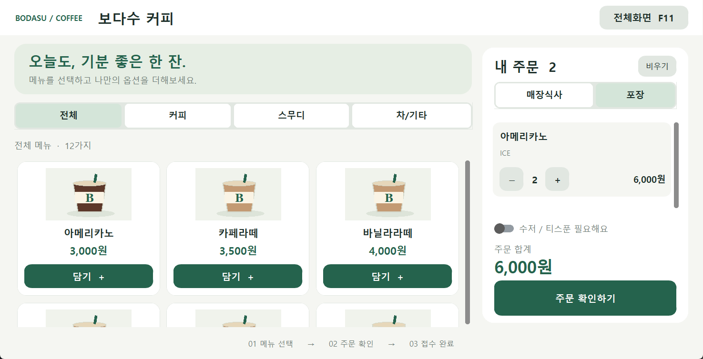
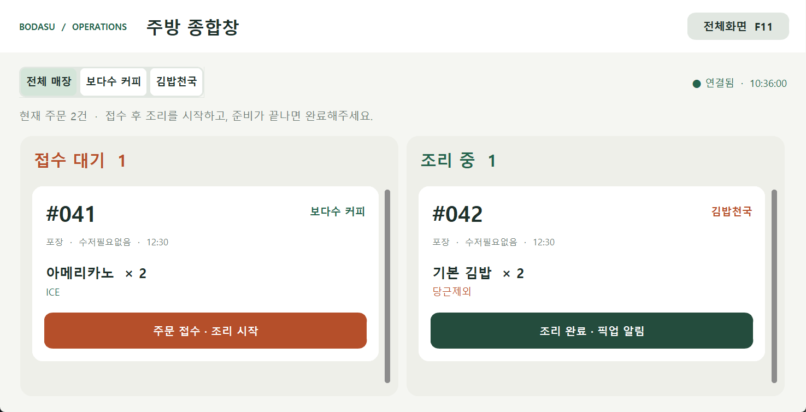
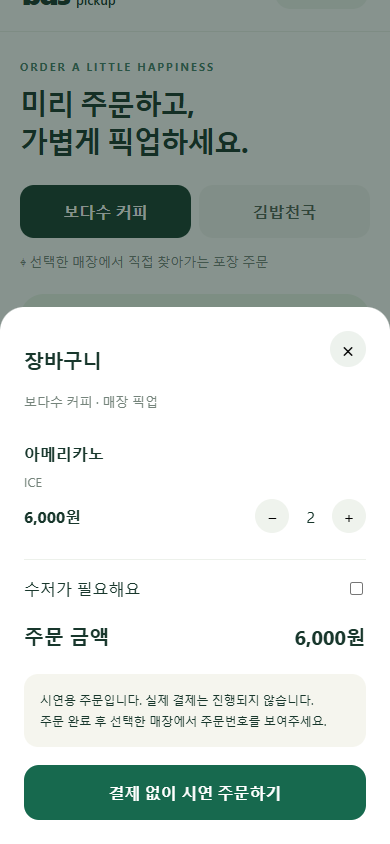
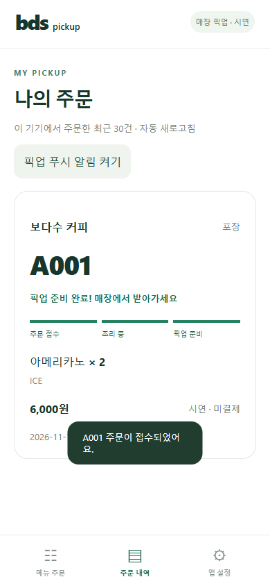
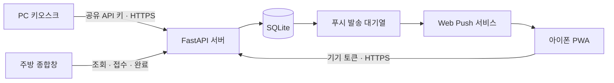

# BDS · 보다수 키오스크 & 모바일 픽업

**PC 키오스크 주문과 아이폰 픽업 주문을 하나의 주방에서 처리하는 과제 발표용 프로젝트입니다.**

PC 화면은 Tkinter 기반 **CustomTkinter**, 중앙 서버는 **FastAPI + HTTPS**, 데이터 저장은 **SQLite**입니다. 아이폰에서는 Safari의 **홈 화면에 추가**로 설치하는 PWA를 사용합니다. 앱스토어 네이티브 앱은 아니며 실제 결제는 진행하지 않습니다.

- 커피 12종·김밥/식사 11종, 매장별 옵션, 장바구니
- 주방 종합창의 접수 대기 → 조리 중 → 픽업 준비 흐름
- 모바일 `A001`과 키오스크 `001` 주문번호 구분
- 조리 시작·픽업 준비 Web Push와 실패 재시도
- 관리자 로그인·비밀번호 변경, API·UI·DB 모듈 분리
- **실행 파일은 `start.bat` 하나**이며 내부에서 모드를 선택합니다.

## 화면 미리보기

개발 중 테스트 데이터로 촬영한 실제 화면입니다. PC는 GUI 테스트, 모바일은 Edge의 모바일 크기 브라우저 테스트 캡처입니다. 실제 아이폰 푸시 수신 화면을 의미하지 않습니다.

### PC 커피 키오스크



### 주방 종합창



주방 캡처는 키오스크 테스트 주문입니다. 모바일 주문은 같은 위치에 `A`가 붙은 번호로 표시됩니다.

### 모바일 장바구니 · 픽업 준비

<p>
  
  
</p>

## 1. 처음 실행하기

Windows와 Python이 필요합니다. 개발·검증은 **Python 3.12, Windows Edge** 환경에서 진행했습니다. 최초 패키지 설치에는 인터넷 연결이 필요합니다.

1. 저장소를 clone하거나 GitHub 코드 ZIP을 받아 압축을 풉니다.
2. 프로젝트 폴더의 **`start.bat`을 더블클릭**합니다.
3. 실행 모드를 선택하고 관리자 로그인합니다.
4. 운영 센터에서 커피·김밥·주방 화면을 엽니다.

| 선택 | 실행 내용 | 기본 주소/포트 |
|---|---|---|
| `1` PC 전용 | 서버 + 관리자 운영 센터 | `https://127.0.0.1:8443` |
| `2` 아이폰 시연 | 서버 + 운영 센터 + 인증서 설치 안내 | 주문 HTTPS `9443`, 안내 HTTP `9080` |
| `3` 종료 | 실행 취소 | — |

BAT는 `.venv`가 없으면 만들고 필요한 패키지가 없으면 설치합니다. 두 모드 모두 `app.py`를 사용합니다. 별도 `start-mobile.bat`은 삭제하고 통합했습니다.

운영 센터가 직접 시작한 서버·매장 화면은 센터를 닫으면 함께 종료합니다. 기존 서버를 재사용한 경우에는 해당 서버를 종료하지 않습니다. **업데이트 후에는 기존 서버도 종료하고 다시 실행하세요.** 실행 오류는 `logs/server.log`에 기록됩니다.

### 명령줄 실행

```powershell
python -m venv .venv
.venv/Scripts/python.exe -m pip install -r requirements.txt
.venv/Scripts/python.exe app.py

# 아이폰 시연
.venv/Scripts/python.exe app.py --mode mobile-demo
```

```powershell
# 개별 실행: 고객/주방 화면은 서버가 먼저 켜져 있어야 합니다.
.venv/Scripts/python.exe app.py --mode server
.venv/Scripts/python.exe app.py --mode coffee
.venv/Scripts/python.exe app.py --mode gimbap
.venv/Scripts/python.exe app.py --mode kitchen
```

아이폰 시연 중에는 **2번으로 실행한 운영 센터에서 주방·키오스크를 여세요.** 별도 터미널에서 기본 모드로 실행하면 `8443`의 다른 서버에 연결될 수 있습니다.

## 2. 관리자 로그인과 설정

초기 비밀번호는 **`1234`**입니다. 운영 센터의 **관리자 비밀번호 변경**에서 현재 비밀번호·새 비밀번호·확인을 입력합니다. 새 비밀번호는 8~128자이며 현재 비밀번호와 달라야 합니다.

- `.env.admin`에는 평문 대신 무작위 솔트와 **scrypt 해시**를 저장합니다.
- 파일이 처음 없을 때만 초기 설정을 생성하며 손상된 파일은 자동 초기화하지 않습니다.
- 운영 센터와 주방은 로그인 대상입니다. 주방은 독립 프로세스라 별도로 로그인합니다.
- 고객용 커피·김밥 화면은 관리자 로그인을 요구하지 않습니다.
- 관리자 로그인은 **로컬 UI 접근용**이며 REST API의 공유 키 인증과 별개입니다.

공유 API 키는 `.env`의 `BDS_API_KEY`로 관리합니다. 환경변수와 `.env`가 모두 없는 최초 실행에는 임의의 키를 생성해 저장합니다. 기존 `.env`를 사용하는 경우 `BDS_API_KEY`를 설정하세요. 실제 키는 문서·스크린샷·Git에 올리지 마세요.

## 3. 아이폰 / 핫스팟 시연

같은 와이파이뿐 아니라 **아이폰 개인용 핫스팟에 PC를 연결하는 방식**도 사용할 수 있습니다. 주소는 실행 시 PC 콘솔에 표시되는 값을 사용하세요. 이전 네트워크나 다른 PC의 주소를 복사하지 마세요.

1. PC와 아이폰을 같은 네트워크로 연결하고 `start.bat` → **2번**을 선택합니다.
2. 관리자 로그인 후 운영 센터를 켜 둡니다.
3. 아이폰 **Safari**에서 콘솔의 `http://PC주소:9080/`를 엽니다.
4. **아이폰 인증서 프로파일 다운로드** → 허용을 선택합니다.
5. 8분 안에 **설정 → 일반 → VPN 및 기기 관리 → BDS 로컬 시연 인증서 → 설치**를 완료합니다. 다운로드만으로 설치되지 않습니다.
6. **설정 → 일반 → 정보 → 인증서 신뢰 설정**에서 **BDS Local Demo CA 전체 신뢰**를 켭니다.
7. `https://PC주소:9443/mobile/`를 열고 Safari 공유 → **홈 화면에 추가**를 선택합니다.
8. 홈 화면의 **BDS 픽업** 앱을 열어 앱 설정 → **픽업 푸시 알림 켜기**를 누릅니다.
9. 앱에서 주문한 뒤 PC 주방 종합창에서 접수·조리 완료를 처리합니다.

프로파일에는 **공개 루트 인증서 하나만** 들어갑니다. 개인 키나 MDM 기기 관리 설정은 없습니다. 자체 생성한 프로파일이라 서명되지 않음으로 표시될 수 있습니다. 설치할 인증서의 SHA-256 지문은 PC 콘솔과 대조하세요. 시연 후 아이폰의 해당 프로파일을 삭제할 수 있습니다.

푸시는 iOS 16.4 이상 홈 화면 앱, 신뢰된 HTTPS, 사용자 알림 허용이 필요합니다. 서버는 로컬이지만 알림 전달은 Apple 등의 푸시 서비스를 거치므로 **PC와 아이폰 모두 인터넷 연결**이 필요합니다. 인터넷이 없는 LAN에서는 앱을 열어 상태를 확인하는 방식만 가능합니다.

상세 절차: [아이폰 로컬 시연 안내](docs/MOBILE_DEMO.md)

## 4. 주문과 알림 동작



| 항목 | 동작 |
|---|---|
| 고객 흐름 | 메뉴 → 옵션 → 장바구니 → 주문 확인 → 접수번호 |
| 주문 상태 | `PENDING` → `COOKING` → `COMPLETED` |
| 주문번호 | 정수 `order_id` 유지, `APP` 출처만 표시번호에 `A` 추가 |
| 가격 | 클라이언트 가격 대신 DB 메뉴 가격으로 계산·저장 |
| 재시도 | 같은 기기·요청 UUID 재전송은 기존 주문 반환. 내용이 다르면 충돌 처리 |
| 주문 내역 | 해당 기기의 토큰으로 최근 30건 조회. 회원 계정·기기 간 동기화 없음 |
| 푸시 | 상태 변경과 대기열 기록을 같은 트랜잭션으로 처리, 별도 스레드가 발송 |
| 발송 실패 | 최대 8회 재시도, 만료 구독(404/410) 삭제, 재시작 후 미발송 처리 재개 |

전체 순번을 공유하므로 앱 주문이 `A001`, `A004`처럼 건너뛸 수 있습니다. Safari 탭과 설치 앱의 저장 공간이 같다고 가정하지 않으므로 **홈 화면 앱을 설치한 뒤 주문**하세요. 브라우저 데이터를 지우면 기존 주문 조회 토큰도 사라집니다.

주방은 약 1.5초, 열린 모바일 주문 내역은 약 4초 간격으로 조회합니다. 닫힌 앱 알림은 폴링이 아니라 Web Push입니다. PC 키오스크/주방은 `F11` 전체화면, `Esc` 해제를 지원합니다.

## 5. 이번 개편에서 달라진 점

| 영역 | 변경 내용 |
|---|---|
| 구조 | 대형 루트 파일을 `kiosk/api`, `storage`, `clients`로 분리 |
| 중복 통합 | 두 매장 UI·장바구니·HTTP·주문 저장 로직 공유 |
| 실행 | `app.py` 단일 진입점, BAT 하나에서 PC/아이폰 모드 선택 |
| PC UI | 밝은 배경, 큰 메뉴 카드, 매장 색상, 옵션·확인·접수번호 화면 |
| 주방 | 두 매장 종합 보드·필터·접수/완료, 모바일 A 번호 표시 |
| 응답성 | 작업 스레드의 네트워크 결과를 큐로 전달, 중복 전송 방지 |
| 관리자 | 로그인·비밀번호 변경, 별도 환경파일에 해시 저장 |
| 모바일 | PWA 설치·주문·내 주문·픽업 알림 |
| 인증서 | LAN 주소용 인증서·아이폰 설치 프로파일·CA 지문 안내 |
| DB | 데이터 보존형 마이그레이션, 출처·요청번호·단가·푸시 테이블 추가 |
| 보안 | PC TLS 검증·리다이렉트 차단·요청/구독 제한·내부 오류 노출 축소 |
| 문서 | 기획 자료는 `docs/`, 디자인 실험은 `examples/`로 이동 |

과거 공개됐던 PC용 개인 키는 개발 PC에서 새 키로 교체했습니다. 인증서·키·DB 추적은 해제했지만 **과거 커밋의 공개 이력이 지워지는 것은 아닙니다.** 새로 받은 팀원은 자동 생성되는 새 키를 사용하고 기존 작업 폴더의 옛 키를 재사용하지 마세요.

## 6. 팀원에게 공유할 파일

**저장소 링크 또는 GitHub 코드 ZIP 전체를 공유하세요.** 내 PC 폴더를 그대로 압축하면 Git 제외 대상인 비밀파일까지 섞일 수 있습니다.

| 상황 | 공유할 것 | 공유하지 않을 것 |
|---|---|---|
| 팀원 각자 실행 | 소스 전체·`start.bat`·requirements·README | 내 환경파일·DB·개인 키 |
| PC 한 대 + 여러 아이폰 | 실행 중 PC의 준비 페이지 주소·설치 안내 | API 키·관리자 해시·CA 개인 키 |
| 아이폰 인증서 설치 | 준비 페이지의 공개 `.mobileconfig`/`.cer` | `.local` 폴더 전체 |
| 발표자료 | `docs/images/` 이미지·구조도·시연 설명 | 실제 설정값·주문 DB·로그 |

각 PC에서 `.env`, `.env.admin`, `kiosk.db`, 인증서·푸시 키가 필요한 시점에 생성됩니다. 아이폰에는 **접속할 서버 PC의 인증서**를 설치해야 합니다.

Git 제외 대상: `.env*`, `*.env`, `*.pem`, `*.db`, DB WAL/SHM, `.local/`, `.venv/`, `logs/`, Python 캐시. 문서용 이미지는 `docs/images/`에 선별해 포함합니다.

## 7. 유지보수 구조

```text
app.py                     실행 모드 진입점
start.bat                  환경 준비 + 모드 선택
kiosk/
  launcher.py              운영 센터·서버/자식 프로세스 관리
  config.py                환경파일·주소·API 키·경로
  server.py                FastAPI·정적 앱·푸시 작업 수명
  admin_auth.py            비밀번호 해시·검증·저장
  certificates.py          PC 인증서 생성
  mobile_demo.py           LAN 주소·모바일 인증서·설치 안내
  push.py                  VAPID·구독 검증·외부 푸시 발송
  schemas.py               PC API 규격
  mobile_schemas.py        모바일 API 규격
  order_numbers.py         표시번호 규칙
  api/                     인증·메뉴·주문·주방·모바일 라우터
  storage/                 SQL·트랜잭션·초기 데이터·마이그레이션
  clients/                 CustomTkinter UI·장바구니·HTTP
mobile/
  index.html / style.css   모바일 화면 틀·디자인
  app.js / api.js          화면 동작·기기 토큰·API 요청
  push.js / sw.js          알림 구독·서비스 워커·캐시
  manifest.webmanifest     설치 정보
docs/                      유지보수·시연·이전 기획·화면 이미지
examples/                  과거 디자인 실험
tests/                     DB·인증·TLS·브라우저 검증
```

| 바꾸려는 기능 | 먼저 볼 파일 |
|---|---|
| PC 디자인 | `kiosk/clients/ui.py`, `base.py` |
| 주방 화면 | `kiosk/clients/kitchen.py` |
| 모바일 디자인 | `mobile/style.css`, `mobile/app.js` |
| API 규격 | `kiosk/api/`, `schemas.py`, `mobile_schemas.py` |
| DB 열·테이블 | `kiosk/storage/migrations.py` |
| 주문 가격·저장·상태 | `kiosk/storage/orders.py` |
| 초기 메뉴 | `kiosk/storage/seed.py` — 기존 메뉴가 있는 DB는 자동 덮어쓰기하지 않음 |
| 푸시 | `kiosk/push.py`, `kiosk/storage/push.py` |

[유지보수 안내](docs/MAINTENANCE.md)를 함께 참고하세요. 과거 기획 문서는 당시 파일명과 계획을 포함하며 현재 구현은 이 README를 기준으로 합니다.

## 8. 환경변수

| 이름 | 역할 |
|---|---|
| `BDS_API_KEY` | PC 클라이언트와 서버의 공유 API 키 |
| `BDS_SERVER_HOST`, `BDS_SERVER_PORT` | 서버 주소·포트 |
| `BDS_BASE_URL` | PC 클라이언트 접속 URL |
| `BDS_SSL_CERT`, `BDS_SSL_KEY` | 서버 인증서·개인 키 경로 |
| `BDS_SSL_CA` | PC 클라이언트가 신뢰할 인증서/CA |
| `BDS_DB_PATH` | DB 경로, 기본 루트 `kiosk.db` |
| `BDS_DEMO_IP` | 다중 네트워크에서 사용할 IPv4 지정 |
| `BDS_VAPID_KEY_FILE`, `BDS_VAPID_SUBJECT` | 푸시 키 경로·발신 연락처 |
| `BDS_DISABLE_PUSH_WORKER` | `1`이면 테스트용 푸시 발송 중지 |

일반 시연은 별도 설정 없이 실행합니다. 아이폰 모드는 주소·TLS·CA 설정을 자식 프로세스에 전달합니다. 관리자 해시 파일은 별도 `.env.admin`입니다.

## 9. 발표용 보안 범위

- PC 클라이언트도 인증서를 검증하고 인증 헤더가 있는 요청의 리다이렉트를 따라가지 않습니다.
- 서버 가격 계산, 기기 토큰 해시 기반 주문 격리를 적용합니다.
- 모바일 주문/푸시 등록은 **IP당 합계 분당 20회**이며 초과 시 429와 `Retry-After: 60`을 반환합니다.
- **기기당 진행 중 주문 3건·구독 3개**, 전체 앱 주문 200건·구독 300개 한도입니다.
- IP 제한은 단일 서버 메모리 기준이며 재시작하면 초기화됩니다. 회원 인증·대규모 공격 방어를 대체하지 않습니다.
- 푸시는 허용된 HTTPS 서비스 주소만 사용하며 리다이렉트를 차단합니다.
- 관리자 권한 분리·강제 최초 비밀번호 변경·감사 로그는 구현하지 않았습니다.
- 인증서 HTTP 다운로드의 바꿔치기 위험은 자동 해소되지 않습니다. 설치할 인증서 지문을 PC 콘솔과 비교하세요.

실제 결제·영수증 프린터·회원 로그인·취소/환불·재고/영업시간·앱스토어 배포는 범위 밖입니다.

## 10. 검증 결과와 방법

최근 코드 기준 **자동 테스트 26개**, 실제 Edge의 모바일 주문 흐름 검증이 통과했습니다.

| 검증 | 확인 내용 |
|---|---|
| 주문/DB | 매장 옵션·가격·저장·상태 전이·기존 데이터 보존 |
| 모바일 | A 번호·기기 격리·중복 재시도·주문/구독 한도 |
| API | 인증·IP 제한·전달 헤더를 바꿔도 제한 유지 |
| 관리자 | 해시·솔트·변경 검증·손상 파일·저장 실패 처리 |
| TLS | 두 모드 정상 인증서 허용·다른 CA 인증서 거부 |
| 푸시 | 모의 발송·재시도·만료 구독 제거·서비스 워커 처리 |
| 브라우저 | 주문 → 주방 완료 → 픽업, 응답 유실 재시도, 오프라인 복구, 320px 폭 |

아이폰에서 인증서 신뢰 설정 후 접속은 확인했습니다. **잠금 화면 푸시 수신은 발표용 실제 기기로 별도 리허설해야 합니다.** 자동 검증은 실제 Apple 푸시 전달을 대신하지 않습니다.

```powershell
.venv/Scripts/python.exe -m pip install -r requirements-dev.txt
$env:BDS_DISABLE_PUSH_WORKER='1'
.venv/Scripts/python.exe -m unittest discover -s tests -v
.venv/Scripts/python.exe tests/mobile_browser_smoke.py
Remove-Item Env:BDS_DISABLE_PUSH_WORKER
```

테스트는 임시 DB를 사용합니다. 브라우저 검증은 설치된 Windows Edge를 사용하고 임시 서버를 종료합니다. 캡처는 `logs/mobile-review/`에 저장됩니다. 테스트용 푸시 중지 변수는 실제 시연 전에 해제하세요.

## 11. 자주 발생하는 문제

| 증상 | 확인 사항 |
|---|---|
| BAT 실행 실패 | Python 설치/PATH·최초 인터넷 연결·콘솔 오류·`logs/server.log` |
| 서버가 바로 종료됨 | 기존 서버의 포트 사용·인증서 경로·로그 |
| 메뉴 연결 실패 | PC 콘솔과 앱 IP 일치·서버 실행·Python 방화벽 허용. 핫스팟 자체를 오류로 단정하지 않음 |
| 연결이 비공개가 아님 | 해당 PC의 CA 설치·전체 신뢰·IP 일치·PC/아이폰 날짜 |
| 신뢰 목록에 CA 없음 | 다운로드 후 실제 프로파일 설치까지 완료했는지 확인 |
| 네트워크 변경 후 실패 | 서버 재실행·새 IP 확인·필요 시 새 주소로 홈 화면 앱 재설치 |
| 푸시가 안 옴 | 홈 화면 앱·알림 권한·인터넷·서버·집중 모드·푸시 중지 변수 |
| 429 응답 | 모바일 쓰기 제한. 60초 후 재시도 |
| 주문 한도 | 주방에서 기존 주문을 처리한 뒤 재주문 |

현재 모드의 `/health`에서 서버 상태, `/docs`에서 API 문서를 확인합니다. HTTP 안내 `9080`과 HTTPS 주문 `9443`을 혼동하지 마세요.
