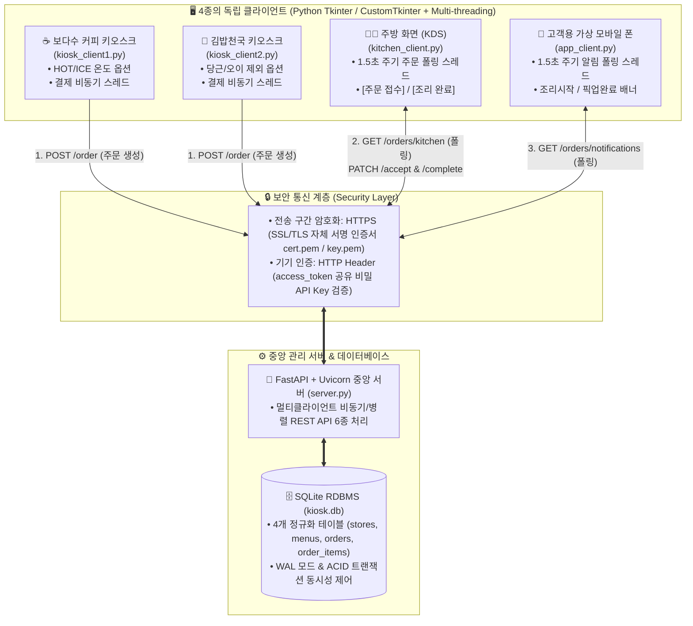

# 📊 통신SW설계 1주차 PPT 발표 자료 구성안 (`oneweek.md`)

본 문서는 **1주차 발표 PPT (총 10페이지, p.1 ~ p.10)** 제작을 위해 슬라이드별 **핵심 본문 텍스트, 도표/다이어그램, 1주차 실제 구현 코드 반영 내용, 발표자 대본(Script)**을 정리한 문서입니다.

---

## 🖼️ [p.1] 표지 (Title Slide)

### 📌 슬라이드 들어갈 텍스트
* **과목명**: 통신SW설계
* **프로젝트 주제**: **멀티 클라이언트 키오스크 및 주방/고객 모바일 실시간 연동 시스템**
* **부제**: FastAPI 중앙 서버(HTTPS/API Key)와 4종의 독립 Tkinter 클라이언트 기반 주문·조리·호출 통합 플랫폼
* **팀명 / 조원**: 보다수(Bodasu) 팀 (팀원 1, 팀원 2, 팀원 3)
* **발표 일자**: 2026년 1주차 프로젝트 설계 및 초기 구축 발표

---

## 🎯 [p.2] 주제 선정 배경 & 기능 목표

### 📌 슬라이드 들어갈 내용

#### 1. 주제 선정 배경 (Why?)
* **소규모 외식 매장의 단절된 주문-조리-호출 프로세스**
  * 카페·분식점 등 무인 키오스크는 보편화되었으나, **① 매장별 상이한 커스텀 옵션(음료 온도 vs 기호 식재료 제외)**, **② 주방 조리 현황판(KDS)**, **③ 고객 모바일 픽업 호출**이 서로 분리되어 종이 주문서 확인 및 육성 호명 등 비효율 발생.
* **멀티 클라이언트 통신 및 스레드 설계의 최적 도메인**
  * 단순 1:1 통신을 넘어 **주문 생성(키오스크 2대) $\rightarrow$ 상태 제어(주방 화면 1대) $\rightarrow$ 실시간 알림 수신(고객용 가상 모바일 폰 1대)**까지 서로 다른 역할을 수행하는 **4개의 독립 클라이언트와 중앙 서버 간 실시간 통신**을 설계·검증하기에 가장 적합함.

#### 2. 핵심 기능 목표 (What?)
* **매장 맞춤형 독립 키오스크 2종 구축**:
  * **보다수 커피 (`KIOSK_01`)**: 음료 12종 + `HOT`/`ICE` 온도 선택 + 매장/포장·수저 옵션
  * **김밥천국 (`KIOSK_02`)**: 분식/식사 11종 + 김밥류 전용 `당근 제외`/`오이 제외` 옵션 + 매장/포장·수저 옵션
* **실시간 주방 관제 및 고객 모바일 알림 연동**:
  * 주방 화면에서 1~2초 주기 폴링으로 신규 주문 즉시 표시 $\rightarrow$ **[주문 접수]** 및 **[조리 완료]** 원클릭 처리
  * 고객용 가상 모바일 폰 화면에 *"조리가 시작되었습니다"* / *"조리가 완료되었습니다! 픽업대에서 수령해 주세요"* 실시간 알림 배너 팝업 출력

> 🎤 **발표 멘트 요약**:  
> "저희 조는 실제 카페와 분식점 매장에서 주문부터 주방 조리, 고객 호출까지 이어지는 전 과정을 하나의 네트워크로 통합하는 '멀티 클라이언트 키오스크 및 주방/고객 연동 시스템'을 주제로 선정했습니다."

---

## 🏗️ [p.3] 시스템 구성도 (System Architecture)

### 📌 슬라이드 들어갈 다이어그램 & 설명



* **1주차 구축 완료 사항**: 중앙 서버(`server.py`), DB 스키마(`database.py`), 데이터 규격(`schemas.py`), SSL 인증서(`cert.pem`/`key.pem`), 키오스크 프로토타입(`kiosk_client1/2.py`, `mega_test.py`) 기본 골격 완성.

---

## 🖥️ [p.4] 서버 & 클라이언트 역할과 기능

### 📌 슬라이드 들어갈 표 (1 Server + 4 Clients)

| 구성 요소 | 파일명 | 주요 역할 및 핵심 기능 | 멀티클라이언트 / 통신 방식 |
| :--- | :--- | :--- | :--- |
| **중앙 서버** | `server.py` | • 모든 클라이언트의 주문·상태·알림을 중재하는 **중앙 REST API 허브**<br/>• `access_token` 헤더 검증 및 SQLite DB 트랜잭션 저장 | **완벽 지원** (`FastAPI` + `Uvicorn` 비동기/멀티스레드 풀로 동시 요청 병렬 처리) |
| **클라이언트 1<br/>(보다수 커피)** | `kiosk_client1.py` | • 커피(5)·스무디(2)·차/기타(5) 총 12종 메뉴 제공<br/>• **`HOT` / `ICE` 음료 온도 옵션** 및 포장/수저 선택 후 주문 전송 | 결제 시 `POST /order` 비동기 HTTPS 전송 |
| **클라이언트 2<br/>(김밥천국)** | `kiosk_client2.py` | • 김밥류(7)·식사/분식류(4) 총 11종 메뉴 제공<br/>• 김밥 전용 **`당근 제외` / `오이 제외` 체크박스** 및 포장/수저 선택 | 결제 시 `POST /order` 비동기 HTTPS 전송 |
| **클라이언트 3<br/>(주방 화면)** | `kitchen_client.py` | • 매장 구분(커피/김밥), 세부 옵션이 적힌 주문서 카드 실시간 표시<br/>• 직원이 **[주문 접수]**(`COOKING`), **[조리 완료]**(`COMPLETED`) 클릭 | 1.5초 간격 백그라운드 폴링(`GET /orders/kitchen`) 및 상태 변경(`PATCH`) |
| **클라이언트 4<br/>(가상 모바일 폰)** | `app_client.py` | • 스마트폰 외형 프레임 UI에서 내 주문 상태 실시간 모니터링<br/>• **조리 시작 안내** 및 **조리 완료 픽업 알림** 팝업 배너 표시 | 1.5초 간격 백그라운드 폴링(`GET /orders/notifications`) |

---

## 🧵 [p.5] Thread 구성 여부 & 동기화 (★ 핵심 설계 포인트)

### 📌 슬라이드 들어갈 내용

#### 1. 쓰레드(Thread) 구성 여부: **클라이언트 백그라운드 멀티스레드 적극 도입**
* **키오스크 1·2 (1회성 Worker 스레드)**:
  * 결제 버튼 클릭 시 서버로부터 HTTPS 응답이 올 때까지 메인 GUI 화면이 멈추는 **'UI 프리징(렉)' 현상을 방지**하기 위해 `threading.Thread(..., daemon=True)`로 네트워크 I/O 분리.
* **주방 화면 & 가상 모바일 폰 (주기적 Polling 데몬 스레드)**:
  * 화면 조작(메인 스레드)과 독립적으로 **1.5초마다 서버에 신규 주문/알림 유무를 물어보는 백그라운드 반복 스레드** 구동.

#### 2. 쓰레드 동기화(`threading.Lock`) 사용 여부: **파이썬 코드 레벨 Lock '미사용'**
* **왜 파이썬 `Lock`을 쓰지 않았는가? (미사용 이유)**:
  * 수업 시간 예제와 동일하게, **서버 프로세스 내부 메모리(In-Memory 전역 리스트/변수)를 공통 메모리로 사용하지 않도록 설계**했기 때문임.
  * 만약 서버 전역 변수에 주문을 저장하면 `threading.Lock`이 필수이지만, 서버 재시작 시 주문 데이터가 모두 증발하는 한계가 있음.
* **공통 데이터 충돌(Race Condition)은 어떻게 해결했는가? (동기화 처리 방법)**:
  1. **서버 데이터 동기화 $\rightarrow$ DB 트랜잭션(ACID) 및 WAL 모드에 위임**:
     * 모든 공유 상태는 중앙 **SQLite RDBMS(`kiosk.db`)**에만 존재하며, 키오스크 2대와 주방이 동시에 접근해도 **DB 엔진 자체의 트랜잭션 격리(Isolation)와 `WAL(Write-Ahead Logging)` 잠금 메커니즘**이 순차적 무결성을 100% 보장함.
  2. **클라이언트 UI 스레드 안전성 $\rightarrow$ `root.after()` 이벤트 큐 위임 (Lock-free)**:
     * 백그라운드 통신 스레드는 UI 위젯을 직접 수정하지 않고, `self.after(0, callback)`을 통해 **Tkinter 메인 스레드 이벤트 큐로 화면 갱신을 위임**하여 스레드 충돌을 원천 차단함.

---

## 🎨 [p.6] UI 연동법 (사용 언어, 프레임워크 및 통신 연동)

### 📌 슬라이드 들어갈 내용

* **개발 언어 및 GUI 프레임워크**:
  * **Language**: `Python 3.12`
  * **Client UI**: `Tkinter` (`ttk`) 및 `CustomTkinter` (`ctk` - 메가커피 스타일 모던 카드 레이아웃 프로토타입 `mega_test.py` 검증 완료)
  * **Server Framework**: `FastAPI` + `Uvicorn` (자동 생성되는 Swagger UI `https://127.0.0.1:8443/docs`를 통해 서버 API 실시간 테스트 지원)
* **UI $\leftrightarrow$ 백그라운드 스레드 $\leftrightarrow$ 중앙 서버 연동 흐름**:
  ```text
  [사용자 터치/클릭 (Tkinter Mainloop)]
       │
       ▼ (1) 이벤트 발생 (결제하기 버튼 클릭 또는 1.5초 타이머)
  [Worker Thread 생성 (threading.Thread)]
       │
       ▼ (2) requests.post("https://127.0.0.1:8443/order", headers={"access_token": ...}, json=payload)
  [FastAPI 중앙 서버 (server.py) & SQLite DB (database.py)]
       │
       ▼ (3) JSON 응답 수신 ({"status": "OK", "order_id": 1, "total_price": 3000})
  [self.after(0, _on_order_success, data)] ──► [Tkinter 메인 스레드에서 안전하게 팝업/장바구니 갱신]
  ```

---

## 🗄️ [p.7] DB 소개 및 트랜잭션 설계 (`database.py`)

### 📌 슬라이드 들어갈 내용

#### 1. RDBMS 선정: **Python 내장 `SQLite3` (`kiosk.db`, WAL 모드 활성화)**
* 별도 무거운 DB 서버 설치 없이 3인의 팀원 PC 및 발표장 환경에서 100% 동일한 동작 보장
* `PRAGMA foreign_keys = ON;` 및 `PRAGMA journal_mode = WAL;` 적용으로 외래키 무결성과 다중 읽기/쓰기 동시성 확보

#### 2. 정규화된 4대 테이블 스키마 (ERD 구조)
1. **`stores` (매장 마스터)**: `store_id` (PK: `KIOSK_01`, `KIOSK_02`), `store_name`, `device_ip`
2. **`menus` (메뉴 마스터 - 초기 23종 자동 Seeding)**: `menu_id` (PK), `store_id` (FK), `category`, `menu_name`, `price`
3. **`orders` (주문 마스터 및 상태 관리)**:
   * `order_id` (PK), `store_id` (FK), `order_type` (`매장식사`/`포장`), `spoon_needed`, `total_price`
   * `status` (`PENDING` 미접수 $\rightarrow$ `COOKING` 조리중 $\rightarrow$ `COMPLETED` 조리완료)
   * `notified_accepted`, `notified_completed` (고객 모바일 폰 알림 중복 방지 플래그), `order_time`
4. **`order_items` (주문 상세 및 매장별 옵션)**:
   * `item_id` (PK), `order_id` (FK), `menu_id` (FK), `quantity`
   * `temperature` (`HOT`/`ICE`), `exclude_carrot` (`당근포함`/`당근제외`), `exclude_cucumber` (`오이포함`/`오이제외`)

#### 3. 트랜잭션(Transaction) 원자성 보장 (`create_order_transaction`)
* 장바구니에 담긴 여러 메뉴를 주문할 때 `orders` 마스터 테이블 INSERT와 `order_items` 상세 테이블 다중 INSERT를 **하나의 트랜잭션으로 묶어 처리**.
* 도중에 잘못된 메뉴나 오류가 발생하면 즉시 `conn.rollback()`을 수행하고, 모두 성공했을 때만 `conn.commit()`을 수행하여 반쪽짜리 주문 데이터가 생기는 현상을 완벽히 방지함.

---

## 🔒 [p.8] 인증 & 암호화 보안 설계 (`config.py`, `generate_cert.py`, `server.py`)

### 📌 슬라이드 들어갈 내용

#### 1. 왜 ID/PW 로그인이 아닌 **API Key 헤더 인증(`access_token`)**인가?
* **도메인 특성 반영 (M2M, Machine-to-Machine)**:
  * 매장 키오스크와 주방 모니터는 일반 고객이 매번 아이디/비밀번호를 입력해 로그인하는 웹사이트가 아니라, **매장에 고정 설치된 인가 단말기**임.
* **구현 방식**:
  * 중앙 서버와 인가된 4대의 클라이언트가 `.env` 환경변수로 주입된 공유 비밀키(`access_token`)를 보유.
  * FastAPI의 `Security(APIKeyHeader(name="access_token"))` 의존성 주입을 통해 모든 API 호출 시 헤더를 검증하며, 키가 없거나 불일치할 경우 즉시 **`HTTP 403 Forbidden`**으로 외부 불법 접근을 100% 차단함.

#### 2. 왜 **HTTPS (SSL/TLS) 통신 구간 암호화**를 결합했는가?
* **API Key 평문 노출 방지**:
  * 일반 HTTP 통신을 사용하면 네트워크 패킷 감청(Wireshark 스니핑 등) 시 HTTP 헤더에 담긴 `access_token`과 주문 내역(JSON)이 평문으로 그대로 노출됨.
* **구현 방식 (1주차 구현 완료)**:
  * `generate_cert.py`를 통해 **RSA 2048비트 개인키(`key.pem`)와 X.509 자체 서명 인증서(`cert.pem`)**를 생성.
  * `uvicorn.run(..., ssl_keyfile="key.pem", ssl_certfile="cert.pem")`으로 중앙 서버를 `https://127.0.0.1:8443` 보안 포트로 구동하여 **기기 인증(API Key) + 전송 구간 암호화(SSL/TLS)** 이중 보안을 달성함.

---

## 📅 [p.9] 업무 분담 / 주차별 계획 / 정량적 목표

### 📌 슬라이드 들어갈 내용

#### 1. 3인 팀 역할 분담 (Role Division)
| 담당자 | 담당 파트 | 담당 파일 | 핵심 업무 내용 |
| :---: | :--- | :--- | :--- |
| **팀원 1** | **중앙 서버 & DB/보안** | `server.py`, `database.py`, `generate_cert.py`, `schemas.py` | FastAPI 6종 REST API, SQLite 4개 테이블 및 트랜잭션, HTTPS 인증서 및 API Key 보안 검증 |
| **팀원 2** | **매장별 키오스크 2종** | `kiosk_client1.py`, `kiosk_client2.py`, `mega_test.py` | 보다수 커피(HOT/ICE) 및 김밥천국(당근/오이 제외) 키오스크 GUI, 장바구니 및 비동기 결제 스레드 |
| **팀원 3** | **주방 화면 & 가상 모바일 폰** | `kitchen_client.py`, `app_client.py` | 주방 화면 एवं 고객용 가상 모바일 폰 GUI, 1.5초 주기 백그라운드 폴링 스레드 및 실시간 알림 배너 연동 |

#### 2. 6주차 개발 로드맵
* **1주차 (완료)**: 요구사항 분석, SQLite 4개 테이블 스키마 및 23종 메뉴 Seeding, SSL 인증서 생성, 서버/키오스크 기본 프로토타입 구축
* **2주차**: FastAPI 중앙 서버(`server.py`) 6대 엔드포인트 고도화 및 보안 검증 테스트
* **3주차**: 보다수 커피 키오스크(`kiosk_client1.py`) UI 디자인 고도화 및 주문 연동 완성
* **4주차**: 김밥천국 키오스크(`kiosk_client2.py`) 기호 옵션 UI 및 주문 연동 완성
* **5주차**: 주방 화면(`kitchen_client.py`) 및 고객용 가상 모바일 폰(`app_client.py`) 폴링 연동 구현
* **6주차**: 5개 프로세스 동시 구동 통합 테스트, 정량적 지표 측정 및 최종 발표

#### 3. 프로젝트 정량적 목표 (Quantitative KPIs)
1. **핵심 REST API 구축 및 스키마 매칭률**: 주문·주방·알림 등 **핵심 서버 API 6종 100% 구현 및 매칭률 100%**
2. **멀티 클라이언트 동시 처리 정합성**: 4개 클라이언트 동시 요청 시 **주문 데이터 유실률 0% (DB 트랜잭션 저장 성공률 100%)**
3. **실시간 알림 종단 간 지연 시간(Latency)**: 주방 `[주문 접수]`/`[조리 완료]` 클릭 후 고객 가상 모바일 폰에 알림이 뜨기까지 **2.0초 이내** 달성
4. **서버 응답 속도 및 UI 반응성**: 단건 주문 API 응답 평균 **200ms 이내**, 통신 중 키오스크 **UI 프리징(멈춤) 시간 0초**
5. **미인가 접근 차단율**: 잘못된 `access_token` 요청에 대한 **서버 차단율 100% (`HTTP 403 Forbidden`)**

---

## 📚 [p.10] 참고 레퍼런스 (메가오더 / 공식 문서 / AI 활용)

### 📌 슬라이드 들어갈 내용

#### 1. 서비스 UI/UX 및 도메인 벤치마킹: **메가MGC커피 키오스크 & '메가오더(Mega Order)'**
* **키오스크 UI 레퍼런스**:
  * 메가커피 매장의 노란색/다크브라운 고대비 시인성 레이아웃, 상단 카테고리 탭, 직관적인 메뉴 카드 그리드 및 `HOT`/`ICE` 선택 인터페이스를 벤치마킹하여 `mega_test.py` 및 `kiosk_client1.py` 설계에 반영.
* **주방-고객 모바일 알림 프로세스 레퍼런스 ('메가오더' 앱)**:
  * 메가오더 및 매장 주문 시 **[결제 완료 $\rightarrow$ 매장 주문 접수(조리 시작 알림) $\rightarrow$ 제조 완료(픽업 호출 알림)]**으로 이어지는 3단계 실시간 상태 알림 UX를 벤치마킹하여 주방 화면(`kitchen_client.py`)과 고객용 가상 모바일 폰(`app_client.py`)의 폴링 시나리오로 구현.

#### 2. 기술 공식 문서 (Technical Documentation)
* **FastAPI Official Docs**: Security & APIKeyHeader (`https://fastapi.tiangolo.com/tutorial/security/`)
* **Uvicorn Official Docs**: Running with HTTPS / SSL (`https://www.uvicorn.org/deployment/#running-with-https`)
* **Python 3 Standard Library Docs**: `sqlite3` (WAL & Transaction), `threading`, `tkinter`

#### 3. AI 페어 프로그래밍 활용 내역 (필수 캡쳐 첨부 영역)
* **활용 도구**: Google Gemini / Antigravity
* **주요 프롬프트 및 설계 검증 내역 (발표 자료 뒷장 또는 우측에 캡쳐 이미지 첨부)**:
  1. 4개 정규화 테이블(`stores`, `menus`, `orders`, `order_items`) 스키마 및 트랜잭션 설계 프롬프트
  2. 스레드 동기화(`threading.Lock`) 미사용 근거(DB 트랜잭션 위임 및 `root.after` 이벤트 큐 분리) 아키텍처 검증 프롬프트
  3. FastAPI `access_token` 헤더 인증 및 자체 서명 SSL 인증서(`cert.pem`, `key.pem`) 생성 코드 구현 프롬프트

